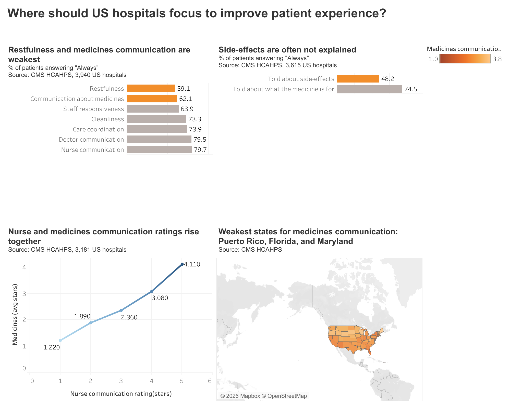

# Where should US hospitals focus to improve patient experience?
SQL and Tableau analysis of CMS HCAHPS hospital survey data, looking for where US hospitals fall furthest behind on patient experience 

## Key findings
- ** The weakest areas overall are restfulness, medicines communication, and staff responsiveness.**
- ** On average, 59% of patients answered "always" for restfulness of the hospital environment, 62% for communication about medicines and 64% for staff responsiveness.**
- ** Communication with nurses and doctors scores highest (about 80%).**
- ** Side effects are the weak spot in medicines communication.** On average, 75% of patients said staff always explained what a new medicine was for, but only 48% said staff always explained its possible side effects. That is the second-lowest "always" score in the survey, after patients getting the rest they needed (43%).
- ** It's a system-wide problem.** Even in 5-star hospitals, about 1 in 8 patients said staff only sometimes or never explained their medicines.
- ** Nurse communication is closely linked.** Hospitals with 5-star nurse communication average 4.11 stars for medicines communication, compared with 1.22 for hospitals with 1-star nurse communication (3,181 hospitals).

## Dashboard
[View the interactive dashboard on Tableau Public](https://public.tableau.com/authoring/Wherehospitalsshouldfocusonpatientexperience/Dashboard1#1)

## Data and tools
**Data:** [CMS Patient survey (HCAHPS) - Hospital](https://data.cms.gov/provider-data/dataset/dgck-syfz), survey period 1 January to 31 December 2025, accessed November 2026.
- 3,940 hospitals had scores for the area percentages
- 3,615 hospitals had scores for the individual questions
- 3,181 hospitals had star ratings (CMS only gives stars to hospitals with at least 100 completed surveys)
- The individual questions cover fewer hospitals because CMS marked more of their scores as "Not Available".
All figures are averages across hospitals. As a check, my results for the two medicines questions (74.5% for what a medicine was for, 48.2% for side effects) are close to the [CMS national figures](https://data.cms.gov/provider-data/dataset/99ue-w85f) of 75% and 49%.
**Tools:** SQLite for the analysis, Tableau Public for the dashboard.

## Analysis, step by step
**1. Which areas score lowest?**
By the share of patients answering "always" (3,940 hospitals), the lowest areas are restfulness of the hospital environment (59.1%), communication about medicines (62.1%) and staff responsiveness (63.9%). Average star ratings (3,181 hospitals) point to the same two weakest areas: medicines (2.77 stars) and restfulness (2.88). By stars, nurse communication  and cleanliness score highest ; by percentage, communication with nurses (79.7%) and doctors (79.5%). More hospitals report percentages than star ratings, because star ratings need at least 100 completed surveys.
**2. Where do good and poor hospitals differ most?** 
Comparing hospitals rated 4 to 5 stars overall with those rated 1 to 2 stars, the biggest gaps are nurse communication (2.08 stars) and staff responsiveness (1.98). Nurse communication is a strength on average, but poorly rated hospitals fall furthest behind on it. Communication about medicines averages only 3.49 stars even in top hospitals.
**3. How often do patients miss out on medicine explainations?**
On average, 62.1% said staff always explained their medicines, 19.0% said usually and 18.9% said sometimes or never. So nearly 4 in 10 patients did not get an explanation every time.
**4. Is it only a problem in poor hospitals ?**
No. The share saying staff sometimes or never explained medicines falls steadily with overall rating: 29.9% (1 star), 24.7% (2 stars), 21.0% (3 stars), 17.3% (4 stars) and 12.1% (5 stars). Even in 5-star hospitals, about 1 in 8 patients had this experience, so it is a system-wide issue.
**5. Which part of medicines communication is weak? (3,615 hospitals)**
74.5% said staff always explained what a new medicine was for, but only 48.2% said staff always explained its possible side effects. The gap is mainly about side effects.
**6. Is nurse communication linked?**
Hospitals with 1-star nurse communication average 1.22 stars for medicines communication, rising to 4.11 stars for hospitals with 5-star nurse communication (3,181 hospitals). This shows a strong link, though not proof that one causes the other.
**7. Where is it weakest by state?**
Weakest: Puerto Rico (1.3 stars), Florida (2.19), Maryland (2.21). Strongest: Maine (3.8), Vermont (3.69), Wisconsin (3.68).

## Why I focused on medicines communication
Restfulness had the lowest score overall, so it would have been the obvious place to start. I chose medicines communication instead.
From a clinical point of view, this is a safety issue more than a comfort one. When patients aren't told what side effects to expect, they are less likely to recognise an adverse reaction early, and more likely to stop a medicine on their own when something unexpected happens. In my own clinical work as a dentist, I saw this often: patients stopped a medicine early because a side effect worried them and nobody had warned them about it. Poor adherence like this can mean treatment doesn't work or patients end up back in hospital, especially with high-risk medicines such as anticoagulants, opioids and insulin.
The data points the same way. Restfulness scores vary a lot between good and poor hospitals, which suggests some hospitals have already found ways to improve it. Medicines communication stays low even in top-rated hospitals (3.49 stars), so very few have solved it.
It's also practical. Explaining side effects is a small change to how staff already give medicines, so it's quick and cheap to test. Restfulness often depends on things that are harder to change, like shared rooms, equipment alarms and night-time observations. And because nurse communication already scores well and is closely linked to how patients rate medicines communication, there's a strength to build on.
Restfulness is still worth looking at in future work.

## Recommendations
Based on these findings, I would suggest hospitals start with three changes:
1. Use teach-back whenever a new medicine is given. The nurse explains what the medicine is for and its two or three most common side effects, then asks the patient to repeat it in their own words. It takes a minute or two and fits into the existing medicine round.
2. Add a side-effects prompt to the medicine round, for example on the medication chart or in the electronic prescribing system, so explaining side effects becomes routine rather than relying on memory.
3. Offer pharmacist counselling for high-risk medicines such as anticoagulants, opioids and insulin, with a short written leaflet patients can take home.
To track progress, I would use two measures: the share of patients who say staff always explained side effects (48% on average across hospitals), and the share of new medicines where teach-back was recorded, checked monthly. A realistic first-year aim would be for 60% of patients on pilot wards to say side effects were always explained, tested in small PDSA cycles before rolling out more widely.
The main barrier is likely to be time on busy wards. I would test the prompt quickly on one ward first, then build it into the electronic medication record, where teach-back can be recorded automatically and tracked monthly without extra paperwork. Hospitals could also give patients simple side-effect information they can open on their phone, for example through a QR code or the patient portal.

## Limitations
- The survey shows where patients report gaps, but not why they happen. The next step would be qualitative work, such as short interviews or focus groups with nurses, pharmacists and patients, to understand why side effects are often not explained.
- Figures are averages across hospitals, not across all patients, so a small hospital counts the same as a large one. This is why my results differ slightly from CMS's national averages, for example, 48% against 49% for side effects (see data and tools).
- The link between nurse communication and medicines communication is a correlation. It doesn't prove that improving one will improve the other.
- Star ratings only cover hospitals with at least 100 completed surveys, so smaller hospitals are left out of those comparisons.
- The data comes from US hospitals, so results may not apply directly to other health systems.
- The recommendations are based on the findings and my clinical experience. They haven't been tested, which is why I suggest starting with small PDSA cycles.

## Files
- `cleaning.sql`: cleaning the raw CMS data
- `analysis.sql`: all SQL queries used in the analysis
- `always_pct.csv`: share of patients answering "always" by area
- `nurse_medicines.csv`: medicines communication stars by nurse communication rating
- `state_medicines.csv`: medicines communication stars by state
- `patient-experience-dashboard.png`: screenshot of the Tableau dashboard
